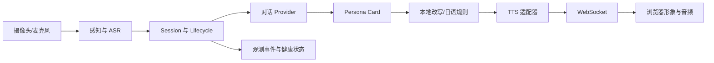

# Alter-Ego

Alter-Ego 是一个面向边缘 AI 开发板的端侧虚拟形象交互运行时。项目把摄像头感知、语音输入、人格化回应、日语表达转换、语音输出和前端形象展示组织成一条可替换、可观测的交互链路。

项目的目标不是把一个固定角色写死在程序里，而是提供一套可以更换人格卡、语料、声音和形象素材的运行时。角色素材与引擎分离，使用者可以在拥有合法授权的前提下导入自己的角色包。

## PC 端快速使用（Windows PowerShell）

需要 Python 3.10 或 3.11、Git 和浏览器。以下命令在 PowerShell 中执行，会将仓库克隆到当前 Windows 用户目录下的 `alter-ego` 文件夹，并打印完整路径。fixture 模式只使用公开代码和内置模拟服务，不需要板卡、摄像头、模型权重、API 密钥或私人角色包。

```powershell
$projectDir = Join-Path $env:USERPROFILE 'alter-ego'
git clone https://github.com/pqyyyyyyyy/alter-ego.git $projectDir
Set-Location -LiteralPath $projectDir
(Get-Location).Path
python -m venv .venv
.\.venv\Scripts\python.exe -m pip install "fastapi>=0.110" "uvicorn[standard]>=0.27" "websockets>=12.0" "pyyaml>=6.0" "requests>=2.31" "janome>=0.5"
.\.venv\Scripts\python.exe scripts/run_service.py --fixture --port 8000 --log-dir tmp/pc-run-logs
```

仓库已经在电脑上时，跳过 `git clone`，用实际完整路径进入项目目录。如果不知道路径，可在资源管理器中打开包含 `README.md` 的项目文件夹，点击地址栏复制完整路径，再执行 `Set-Location -LiteralPath '复制的路径'`；也可以在该文件夹地址栏输入 `powershell` 并按回车，直接在此处打开终端。通过浏览器下载 ZIP 的用户需要先解压，进入解压后包含 `README.md` 的文件夹。

在浏览器打开 `http://127.0.0.1:8000/`，等状态显示“已连接”后在输入框发送文字。页面会显示模拟角色的日语回复和中文字幕，并播放短提示音；该声音不是语音合成。fixture 没有立绘，舞台上不会出现角色图片，录音预览也是模拟识别。用另一个 PowerShell 窗口检查服务：

```powershell
Invoke-RestMethod http://127.0.0.1:8000/health
```

关闭服务时在运行窗口按 `Ctrl+C`。端口被占用时将命令中的 `8000` 改成其他空闲端口，并用相同端口打开网页。`scripts/run_service.py` 会自行设置子进程的 `PYTHONPATH`，按上述命令启动不需要手动设置。更换真实角色、对话、语音和摄像头的步骤见下方[PC 端深入使用](#pc-端深入使用)。

## 项目要解决的问题

在 8 TOPS 级边缘设备上同时运行视觉、语音和对话模块时，有限的 NPU、CPU 和内存会产生资源争用。若所有模型一直驻留，设备容易超出资源预算；若每次请求都重新加载模型，首次响应会出现明显延迟。

Alter-Ego 使用统一的生命周期和调度器管理一次交互：输入开始时申请资源，模型处理完成后进入播放等待，播放确认或超时后释放资源。忙碌时明确返回 `busy`，不把新的麦克风输入排队到旧轮次后面，从而避免语音回授和迟到结果污染下一轮对话。

## 核心能力

- **人格卡片接口**：使用 YAML 描述身份、背景、性格、关系、知识边界、禁谈内容、称呼方式、情绪立绘和状态动画。
- **个性化回应**：对话内容与表达风格分层处理。主对话模块决定“说什么”，本地改写模块决定“怎么说”，角色更换时不需要修改服务代码。
- **日语表达转换**：`ja_politeness.py` 使用日语分词和规则处理敬体、常体、疑问句及角色语尾，保证日语角色的表达转换具有确定性，并减少小模型改写的不稳定性。
- **多后端 LLM 接口**：通过 `providers.yaml` 选择本地 llama.cpp、DashScope、DeepSeek 或智谱等后端。API 密钥只从环境变量读取，不写入仓库。
- **语音输入与输出适配**：ASR 支持本地 SenseVoice/sherpa-onnx 模型；TTS 支持 Edge TTS 和 GPT-SoVITS HTTP 适配器。具体模型文件和声音素材由部署者自行提供。
- **人脸感知与身份档案**：提供摄像头采集、SCRFD 检测、ArcFace 特征提取、多帧投票和身份档案接口。运行时只使用本地身份特征，不把人脸原图或特征库提交到仓库。
- **多模型协同调度**：统一管理语音输入、对话、改写、TTS 和前端播放，支持超时、取消、离开、断连、迟到结果丢弃和进程级监督。
- **前端形象展示**：浏览器通过 WebSocket 接收状态、情绪、字幕、音频和动画消息。服务端为播放连接分配 owner，其他连接只观察，避免多个浏览器重复播放。
- **可观测性**：健康检查、生命周期事件和服务状态均有结构化接口，事件记录不保存原始 PCM、私有正文或访问密钥。

## 运行架构



一轮典型流程如下：

1. 感知链路识别用户出现、离开或身份变化，并将身份绑定到本地会话。
2. 语音输入被切分成完整句子，ASR 将本地 PCM 转换为文本。
3. `Lifecycle` 向 `Coordinator` 申请一个唯一轮次；已有轮次运行时，新请求返回 `busy`。
4. 对话编排器根据人格卡片、当前会话历史和用户文本生成结构化回应。
5. 本地改写器或日语规则引擎处理表达风格，并生成字幕、情绪和目标语音文本。
6. TTS 适配器生成可播放音频；服务端向 WebSocket 播放 owner 发送字幕、情绪和音频。
7. 浏览器回传 `audio_started` / `audio_ended`，服务端确认轮次完成并释放资源。

## 端侧与云端边界

项目面向 OrangePi AIpro 8T / Ascend 310B 类边缘设备设计。感知、ASR、人格卡片、日语规则、会话管理、状态机、TTS 适配和前端链路都可以在本地运行。主对话内容生成可以选择本地后端，也可以在配置了 API 的情况下调用云端 provider；云端只接收对话所需的文本和会话上下文，不接收人脸特征、角色立绘或原始语音文件。

仓库不包含模型权重、个人数据、第三方角色形象或训练音频。部署时需要根据硬件和授权情况准备模型目录、角色素材和语音后端，并通过环境变量或配置文件接入。

## 人格卡片与角色包

默认示例位于 `characters/example/`。一个角色包包含：

```text
characters/<character-id>/
├── persona.yaml       # 身份、风格、语言、情绪和动画映射
├── examples.jsonl     # 中文风格改写使用的示例池
└── sprites/           # 由使用者自行提供的立绘和动画素材
```

`persona.yaml` 可以配置：

- `profile`：身份、背景、关系、熟悉领域、未知领域和禁谈主题；
- `style`：语气、句尾、填充词、自称、对用户称呼和禁用表达；
- `language`：`zh` 使用模型改写路径，`ja` 使用日语规则路径；
- `emotions`：情绪到候选立绘的映射；
- `animations`：待机、唤醒等状态动画的帧序列；
- `rewrite`：温度、top-p、最大输出长度和重试次数；
- `profile.speech_samples` 与 `fallback_reply`：表达参照和离线降级回复。

启动时通过 `ALTER_EGO_CHARACTER` 指定角色目录。例如：

```powershell
$env:ALTER_EGO_CHARACTER = "C:\path\to\characters\my-character"
```

角色包中的立绘、音频和人格资料可能受到版权或隐私限制，不能因为能被程序读取就直接公开发布。

## 主要模块

| 路径 | 作用 |
|---|---|
| `src/alter_ego/contracts.py` | 状态、情绪、身份、对话结果和事件等公共数据契约 |
| `src/alter_ego/dialog.py` | 主对话编排、上下文历史、结构化输出和降级回复 |
| `src/alter_ego/sessions.py` | 用户身份到独立会话的绑定、历史轮次和过期策略 |
| `src/alter_ego/persona/card.py` | 人格卡片解析、校验、情绪立绘和状态动画映射 |
| `src/alter_ego/persona/examples.py` | few-shot 示例池的加载、筛选和渲染 |
| `src/alter_ego/persona/rewriter.py` | 本地口吻改写、情绪判定和输出校验 |
| `src/alter_ego/persona/ja_politeness.py` | 日语敬体/常体与角色语尾的规则转换 |
| `src/alter_ego/persona/output_gate.py` | 输出内容的基本安全和格式门禁 |
| `src/alter_ego/llm/providers.py` | 本地与云端 LLM provider 的统一 HTTP 抽象和降级链 |
| `src/alter_ego/perception/` | 摄像头、存在检测、人脸检测、特征提取和身份比对 |
| `src/alter_ego/voice/` | ASR、TTS、PCM 输入和外部语音服务适配 |
| `src/alter_ego/scheduler/coordinator.py` | 单轮次预约、资源预算、超时、隔离和迟到结果处理 |
| `src/alter_ego/server/lifecycle.py` | 一轮交互从输入到播放确认的生命周期 |
| `src/alter_ego/server/app.py` | FastAPI、HTTP 调试接口、WebSocket 和服务启动配置 |
| `src/alter_ego/server/camera_bridge.py` | 摄像头监控或外部感知服务的桥接 |
| `src/alter_ego/server/voice_output.py` | 音频输出状态和播放确认管理 |
| `src/alter_ego/observability.py` | 有界事件记录、耗时和健康状态 |
| `web/` | 浏览器端状态渲染、字幕、音频播放和立绘动画 |
| `scripts/` | 语音、感知、阈值、服务启动和数据准备工具 |
| `tests/` | 单元测试、服务集成测试、WebSocket 测试和 fixture 测试 |

## 配置与后端选择

`providers.yaml` 只保存 provider 的地址、模型名、超时时间和环境变量名。例如：

```yaml
providers:
  local:
    base_url: http://127.0.0.1:8089/v1
    model: qwen2.5-0.5b-instruct-q4_k_m
    api_key_env: ""
  dashscope:
    base_url: https://dashscope.aliyuncs.com/compatible-mode/v1
    model: qwen-plus
    api_key_env: DASHSCOPE_API_KEY
```

API 密钥应在系统环境变量中设置：

```powershell
$env:DASHSCOPE_API_KEY = "<your-key>"
```

常用运行开关：

| 环境变量 | 作用 |
|---|---|
| `ALTER_EGO_CHARACTER` | 角色包目录 |
| `ALTER_EGO_PERCEPTION=1` | 启用本地摄像头感知 |
| `ALTER_EGO_ASR=1` | 启用本地 ASR |
| `ALTER_EGO_ASR_MODEL` | 本地 ASR 模型目录 |
| `ALTER_EGO_TTS=edge` | 使用 Edge TTS |
| `ALTER_EGO_TTS=gpt-sovits` | 使用 GPT-SoVITS HTTP 服务 |
| `ALTER_EGO_TTS_URL` | GPT-SoVITS `/tts` 地址 |
| `ALTER_EGO_SCHED_BASELINE=1` | 使用基线资源策略进行对比测试 |
| `ALTER_EGO_DEVICE_ID` | 写入健康状态和观测事件的设备标识 |
| `ALTER_EGO_FIXTURE=1` | 启用不打开真实设备的 fixture 模式 |

## PC 端深入使用

先完成上面的快速安装，再在**新的 PowerShell 窗口**中按需接入以下模块。进阶模式关闭 `--fixture` 后才会读取 `providers.yaml`、角色包和真实模型；每次修改环境变量或人格卡后重启服务。页面、`/health` 和 `GET /debug/events` 可用于确认各模块状态。

### 1. 自己的角色与联网对话

将公开示例复制为自己的角色目录，编辑 `persona.yaml` 中的 `name`、`profile`、`style` 和 `emotions`。`examples.jsonl` 需要保留为有效的 JSONL 文件；中文口吻改写会读取它。立绘放在该角色目录的 `sprites/aligned/`，文件名与 `emotions` 映射一致；没有立绘时仍可测试文字链路，但网页不会显示角色图片。新建的 `characters/my-character/` 默认被 `.gitignore` 排除。

```powershell
Copy-Item characters/example characters/my-character -Recurse
$env:ALTER_EGO_CHARACTER = (Resolve-Path characters/my-character).Path
$env:DASHSCOPE_API_KEY = "<你的 API 密钥>"
.\.venv\Scripts\python.exe scripts/run_service.py --port 8000 --log-dir tmp/pc-real-logs
```

上述示例使用 `providers.yaml` 的 `dialog_chain` 中的 DashScope。改用其他兼容服务时，调整该文件的 `dialog_chain`、`base_url`、`model` 和 `api_key_env`，并设置对应环境变量；密钥不要写入 YAML 或提交到 GitHub。打开网页发送文字即可测试完整对话。云端请求会发送对话文本、人格提示和有限轮次上下文，并可能产生 API 费用。

公开的 `characters/example/persona.yaml` 是中文角色示例。中文路径用 `providers.yaml` 中的 `local` llama.cpp 后端做口吻改写；未启动该本地后端时，改写器会退回原文，`/health` 的 `last_rewrite_error` 可显示原因。要启用本地改写，另行准备有使用权的 GGUF 模型和 llama.cpp 服务，使其 `/completion` 地址与 `providers.yaml` 一致。日语角色将人格卡设为 `language: ja`，在 `profile.speech_samples` 写入日语示例，并将 `style.sentence_endings` 改为日语语尾；该路径使用本地敬体转换规则，不依赖小模型生成口吻。

### 2. 语音输入与输出

语音识别需要自行准备 SenseVoice 的本地模型目录，至少包含 `model.int8.onnx` 和 `tokens.txt`，并安装 `requirements.txt` 中的 `numpy`、`sherpa-onnx` 等相关依赖。浏览器录音时音频由当前打开网页的 PC 麦克风采集；服务端读取以下配置：

```powershell
$env:ALTER_EGO_ASR = "1"
$env:ALTER_EGO_ASR_MODEL = "C:\path\to\sensevoice-model"
```

语音输出可选择在线 Edge TTS，或已有的 GPT-SoVITS HTTP 服务。配置其中一种后重启主服务，并在网页打开“语音”开关；真实 TTS 会先进行预热，`/health` 可查看状态。

```powershell
$env:ALTER_EGO_TTS = "edge"
$env:ALTER_EGO_TTS_VOICE = "<与角色语言相符的声音名称>"
```

```powershell
$env:ALTER_EGO_TTS = "gpt-sovits"
$env:ALTER_EGO_TTS_URL = "http://127.0.0.1:9880/tts"
```

第二种方式要求 TTS HTTP 服务已单独启动、`/tts` 可返回 WAV；本仓库不包含该服务的模型权重、训练音频或一键训练流程。具体接口与原板端适配资料见 [`docs/interfaces-v2.md`](docs/interfaces-v2.md)。

### 3. 摄像头与诊断

摄像头感知默认关闭。需要使用时，先安装完整依赖、准备具有相应使用权限的人脸模型，并确认 PC 摄像头可用，然后设置 `ALTER_EGO_PERCEPTION=1`，必要时通过 `ALTER_EGO_CAMERA` 选择摄像头编号。启动后用 `GET /debug/perception` 和 `GET /health` 查看状态。人脸注册工具为 `scripts/enroll_face.py`；人脸照片和特征数据保存在本地 `data/`，不会进入公开仓库。

```powershell
.\.venv\Scripts\python.exe -m pip install -r requirements.txt
$env:ALTER_EGO_PERCEPTION = "1"
$env:ALTER_EGO_CAMERA = "0"
```

诊断时先开网页以建立播放连接，再调用 `POST /debug/chat?text=...` 测试完整文本对话，或用 `POST /debug/say?text=...` 跳过云端只测试改写与播放。`/debug/chat/reset` 清除当前会话历史；`/debug/transcribe` 只预览 ASR，不触发对话或 TTS。详细接口和参数见 [`docs/interfaces-v2.md`](docs/interfaces-v2.md)。

`scripts/run_service.py` 监督它创建的主服务进程，长期无响应时会隔离并结束该进程，不会自动重启。外部 LLM 和 TTS HTTP 服务需分别启动和维护。PC 上运行不等于复现 Orange Pi AIpro 的 NPU、CANN 或整机硬件测试结果。

## HTTP 与 WebSocket 接口

主要接口包括：

- `GET /health`：服务、对话、TTS、ASR、感知和设备状态；
- `GET /debug/events`：有界生命周期事件，用于测试和问题定位；
- `POST /debug/chat?text=...`：完整文本对话链路；
- `POST /debug/say?text=...`：直接测试改写、情绪、字幕和 TTS；
- `POST /debug/pcm`：接收 16 kHz、单声道、S16LE PCM；
- `POST /debug/transcribe`：只做 ASR 预览，不调用对话和 TTS；
- `WS /ws`：前端握手、状态同步、字幕、情绪、音频和播放确认。

WebSocket v2 使用 `turn_id`、`speech_id` 和服务端绑定的 `client_id` 校验播放确认。只有当前播放 owner 的匹配确认可以释放轮次，旧消息、重复确认和观察连接的确认都会被忽略。

详细协议见 [`docs/interfaces-v2.md`](docs/interfaces-v2.md)，历史设计依据见 [`docs/interfaces-v1.md`](docs/interfaces-v1.md)。

## 测试

运行 Python 测试：

```powershell
python -m pytest -q
```

测试覆盖人格卡片解析、日语规则、provider 诊断、会话、调度器、摄像头桥接、ASR/TTS 适配、WebSocket 生命周期、前端协议和进程监督。需要真实模型或角色素材的测试会在资源不存在时跳过，不会把私有素材伪装成仓库内的公共测试数据。

## 公开内容与授权边界

本仓库公开的是运行时代码、接口定义、测试、配置样例和通用示例人格卡。以下内容被 `.gitignore` 排除：

- `models/` 中的模型权重；
- `data/` 中的人脸、语音和用户数据；
- `characters/` 下的私人角色包和立绘；
- 私人语音训练素材、音频输出和本机联调日志；
- API 密钥、私钥、环境文件和本地临时文件。

使用第三方模型、语音、人物形象或音频前，应分别核验复制、训练、改编、展示和再分发许可。第三方资源记录见 [`assets/manifest.yaml`](assets/manifest.yaml)。

## 许可

本项目自研代码采用 Apache-2.0 许可，详见 [`LICENSE`](LICENSE)。第三方依赖和预训练模型遵循各自的许可与使用条件；本项目不以 Apache-2.0 重新许可第三方资源。
